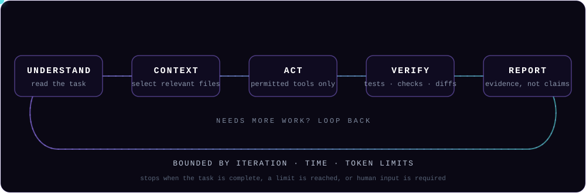
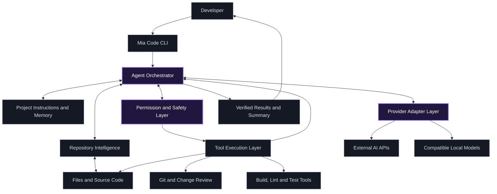

<div align="center">


<br/><br/>



<br/>

**Your codebase. Your AI provider. Your machine. Your control.**

<br/>


<br/>

[**Repository**](https://github.com/MiaCodeAI/Mia-Code) &nbsp;·&nbsp; [**Project overview**](https://github.com/MiaCodeAI/MiaCodeAI) &nbsp;·&nbsp; [**Roadmap**](#-roadmap) &nbsp;·&nbsp; [**Contribute**](#-contributing)

</div>


## ◈ Overview

**Mia Code** is an open-source, cross-platform AI coding agent that helps developers understand, build, debug, test, improve, and maintain software projects directly from their development environment.

Instead of manually explaining your entire project to an AI assistant, Mia Code aims to inspect your repository, understand its structure, identify problems, create a plan, make controlled changes, run relevant tests, and explain the results — without locking you into a single AI company or requiring a subscription to a centralized Mia Code AI service.

> [!NOTE]
> Mia Code is being developed as a **local-first coding agent with Bring Your Own API Key (BYOK)** support. Users will connect compatible AI providers with their own credentials, while repository inspection, file operations, and development tools run on their own machines.
>
> This is an **early-stage project**. Everything described here is the intended product; individual capabilities will arrive as development progresses.

<div align="center">



<sub>Illustrative session showing the intended experience — not a recording of a released build.</sub>

</div>


## ◈ The Vision

A developer should be able to open a terminal in any supported project and say:

```text
Scan my project and tell me what to improve.
```

Mia Code works through the repository, builds an understanding of the application, and produces an **evidence-based report**. With permission, the developer continues:

```text
Fix the most important issues, run the tests, and explain your changes.
```

This is not simple question-and-answer chat. It is an **iterative coding process**: inspect relevant files, use development tools, make controlled edits, evaluate results, and correct mistakes — all within configured limits.

| | |
|---|---|
| **Mission** | Build a capable coding agent that developers can inspect, configure, extend, and use with their preferred AI providers. |
| **Vision** | A future where developers spend less time explaining codebases and doing repetitive maintenance, and more time designing, creating, and solving meaningful problems. |

---

## ◈ Why Mia Code

Modern projects are hard to hold in your head, and today's AI tooling adds friction of its own:

- AI assistants that lack context about the complete project
- Explaining the same architecture again and again
- Coding tools tied to a single AI provider
- Expensive subscriptions or inference controlled by a third party
- Suggested changes that were never tested
- Large projects that exceed a model's context window
- Inconsistent project instructions between sessions
- Automated edits that break things or touch unrelated files
- Little visibility into what an autonomous agent actually did

Mia Code answers with **repository-aware reasoning, provider flexibility, local tools, persistent project instructions, controlled execution, and test-driven verification.**

### Core objectives

| | Objective | What it means |
|:-:|---|---|
| 🔓 | **Open source** | Source and development process publicly accessible under a clearly defined license |
| 🖥️ | **Cross-platform** | Windows, Linux, and macOS with a consistent experience |
| 🔀 | **Provider-independent** | No single AI provider is mandatory |
| 🔑 | **BYOK** | Configure your own supported AI API credentials |
| 🧭 | **Repository-aware** | Inspect files, manifests, docs, dependencies, and relevant source |
| 🤖 | **Agentic workflow** | The model selects from permitted tools and iterates toward an outcome |
| 🛡️ | **Safe execution** | Explicit permission controls on file edits and shell commands |
| ✅ | **Verifiable results** | Run checks; report what passed, failed, or was not run |
| 🧩 | **Extensible design** | Add providers, tools, and capabilities without rewriting the core |
| 🔍 | **Transparent operation** | Show actions, errors, usage, and limitations |


## ◈ How It Works

The AI model provides reasoning and proposes actions. **Mia Code provides the controlled tools** that let those actions touch the project. The model never automatically receives unrestricted access to your computer — access depends on the tools Mia Code implements, the permissions you configure, and the execution environment.

<div align="center">



</div>

<details>
<summary><b>The full workflow, step by step</b></summary>

<br/>

1. The developer opens a terminal in a project directory.
2. Mia Code identifies the repository and discovers relevant files.
3. It reads project instructions and gathers the context required for the task.
4. It sends a focused request and selected context to the configured AI provider.
5. The model proposes an answer or requests a permitted tool action.
6. Mia Code validates the action and applies the relevant permission rules.
7. Approved tools inspect files, apply patches, or run development commands.
8. Results are returned to the model for further reasoning.
9. The agent continues within configured iteration, time, and usage limits.
10. Mia Code summarizes findings, changes, test results, and remaining concerns.

**Error recovery.** When a command or test fails, Mia Code should capture the relevant output, decide whether the failure relates to its changes, and attempt a bounded correction when authorized. It must not claim a problem is fixed merely because code was edited.

</details>

### Operating modes

| Mode | Purpose |
|---|---|
| `Ask` | Answer questions about code and project behavior |
| `Explain` | Explain files, functions, architecture, and execution flow |
| `Audit` | Inspect the project and report findings **without editing files** |
| `Plan` | Produce an implementation plan before making changes |
| `Edit` | Apply focused code modifications under permission rules |
| `Agent` | Work through a multi-step task using permitted tools |
| `Test` | Discover and execute appropriate tests and checks |
| `Review` | Review code changes for defects, regressions, and maintainability |

---

## ◈ The Developer Experience

Describe the outcome you want instead of orchestrating every step.

<table>
<tr>
<td width="50%" valign="top">

**🧠 Understand an unfamiliar project**

```text
mia "Explain this project, its architecture,
and how to run it."
```

Discovers project type and entry points, inspects manifests, maps modules, finds scripts and tests, and flags missing setup docs.

</td>
<td width="50%" valign="top">

**🔎 Audit a project**

```text
mia "Scan my project and tell me
what to improve."
```

Maps the repo, finds likely bugs and risky patterns, prioritizes by severity, and cites files and locations. Read-only in audit mode.

</td>
</tr>
<tr>
<td width="50%" valign="top">

**🛠️ Fix a bug**

```text
mia "Find and fix the login validation bug.
Run the relevant tests."
```

Locates the code and tests, develops a minimal fix, asks permission, applies a focused patch, runs checks, and explains the result.

</td>
<td width="50%" valign="top">

**✨ Add a feature**

```text
mia "Add CSV export to the reports page,
following existing conventions."
```

Studies existing patterns, plans the change, implements it, updates tests, verifies, and summarizes files modified and limitations.

</td>
</tr>
</table>

> These examples illustrate the intended experience. They are not a claim that every command is already implemented.


## ◈ Project Intelligence

A coding agent needs more than a list of filenames. Mia Code aims to build repository intelligence progressively, using techniques appropriate to the size and structure of the codebase.

<table>
<tr>
<td width="50%" valign="top">

**Repository discovery**

- Language and framework
- Entry points and major modules
- Dependency manifests and lockfiles
- Build, dev, lint, and test commands
- Configuration files
- Documentation and project instructions
- Git status and relevant changes
- Existing tests and their layout

</td>
<td width="50%" valign="top">

**Context selection**

Rather than sending every file to a model, Mia Code selects context per task:

- Relevant source files
- Referenced functions and classes
- Related tests
- Project documentation
- Configuration and manifests
- Recent Git changes
- Previous task decisions
- Relevant project instructions

</td>
</tr>
</table>

### Project memory

Mia Code is intended to support a project instruction file:

```text
MIA.md
```

It could describe architecture, coding conventions, important directories, build and test commands, constraints the agent must respect, known technical debt, and preferred patterns. Project memory stays **inspectable and editable** by the developer, and must not silently become an uncontrolled store of secrets or unrelated personal information.

---

## ◈ AI Providers & BYOK

Mia Code uses a **modular provider architecture** so different AI services sit behind one consistent interface. The core agent depends on that interface, not on any single vendor.

<details>
<summary><b>Intended integration targets</b> &nbsp;<sub>(a list of goals — not a statement that each is supported or tested today)</sub></summary>

<br/>

| Provider or service | Intended approach |
|---|---|
| OpenAI | Official API and compatible models |
| Anthropic | Native API integration |
| Google Gemini | Native API integration |
| DeepSeek | Native or compatible API |
| Alibaba Qwen | Native or compatible API |
| Mistral | Native or compatible API |
| xAI | API integration where supported |
| Zhipu GLM | Native or compatible API |
| Moonshot Kimi | Native or compatible API |
| MiniMax | Native or compatible API |
| OpenRouter | Multi-model routing service |
| Groq · Together AI · Fireworks AI · Cerebras · SiliconFlow | Compatible APIs where supported |
| Local model servers | Compatible local endpoints where supported |

</details>

<details>
<summary><b>Provider adapter design</b></summary>

<br/>

Each adapter handles what differs between services: authentication, model selection, request formatting, streaming, tool or function calling, token usage reporting, error normalization, rate limits and retries, and provider-specific context limits.

**OpenAI-compatible APIs.** A generic compatible-provider adapter could connect many services without a bespoke integration for each. Compatibility must still be tested — similar request formats do not guarantee identical support for streaming, tool calls, or structured output.

**Capability differences.** Not every model supports every feature. Mia Code should detect or configure capabilities and explain when an operation is unavailable. A model without the required tool-calling interface may answer questions but not suit the full agent workflow.

</details>

### Bring Your Own API Key

You supply credentials for the services you choose. Mia Code should **not** require requests to pass through a centrally managed inference service.

- Choose providers and models by capability, speed, and price
- Keep control of your provider accounts and billing
- Let the community contribute additional provider adapters

**Credential handling (planned):** prefer the OS credential manager where practical · support environment variables for automation · never commit real credentials · redact keys from logs · never display full keys in normal output · make replacing or removing credentials easy · warn before sending code to an external provider.

> [!IMPORTANT]
> Mia Code is open source, but **external AI inference may not be free**. You remain responsible for your provider's billing, usage limits, and terms. Some providers offer free quotas or local models; others charge per token or request. Usage information will be shown wherever provider APIs expose it reliably.


## ◈ Tools & Capabilities

The tool system is modular, so capabilities can be added without redesigning the application.

| Area | Planned capabilities |
|---|---|
| 📁 **Files** | List, read, and search files · inspect code sections · create files · apply structured patches · compare against originals · respect exclusions (dependencies, generated output, sensitive files) |
| ⌨️ **Terminal** | Run tests, builds, linters, and formatters · check dependency config · inspect Git state · run project-specific validation — all behind permission rules |
| 🌿 **Git** | Inspect the working tree · review diffs · identify unrelated user changes · summarize changes · help prepare commits **only when asked** |
| ✅ **Verification** | Discover the project's existing test approach first · distinguish *passed*, *failed*, *could not run*, and *not attempted* |

Mia Code must not silently discard uncommitted work, rewrite history, or push to a remote without authorization.

**Future extensions:** language-server and IDE integrations · structured dependency analysis · documentation generation · test-generation assistance · code review workflows · plugins · local-model support · advanced repository indexing.

---

## ◈ Safety & Security

An autonomous coding agent must be useful without being careless. Mia Code follows the principle of **least privilege**: only the access the current task requires.

<table>
<tr>
<td width="50%" valign="top">

**🔐 Permission controls**

Distinguishes reading, searching, proposing changes, applying modifications, running ordinary commands, running potentially destructive commands, accessing locations outside the project, and interacting with remote services. You choose which categories need approval.

**📄 File protection**

Preserve user modifications · avoid unchecked overwrites · detect unexpected changes before patching · exclude secrets by default · keep changes focused · show clear diffs · offer recovery guidance.

</td>
<td width="50%" valign="top">

**⚠️ Shell safety**

No unrestricted arbitrary command execution without the user understanding the implications. Risk is weighed by command, working directory, privileges, and potential effects. Destructive or system-wide actions get stronger controls.

**🧱 Prompt-injection resistance**

Repository content is **data, not instructions**. Trust is tiered:

1. System-level safety rules
2. User instructions
3. Explicitly trusted project instructions
4. Untrusted repository content and tool output

</td>
</tr>
</table>

Security findings should be evidence-based and clearly qualified — confirmed problems are distinguished from suspicious patterns that need human verification.


## ◈ Architecture

Separation of concerns: interface, reasoning, tools, safety, context, and providers.



| Layer | Responsibility |
|---|---|
| **CLI** | Commands, interactive prompts, terminal output, configuration |
| **Agent orchestrator** | Coordinates task, model requests, tool calls, iteration limits, completion checks |
| **Repository intelligence** | Discovers files and selects relevant context |
| **Project memory** | Loads explicit project instructions and persistent task information |
| **Permission & safety** | Validates requested operations and enforces approval rules |
| **Tool execution** | Performs approved file, terminal, Git, and verification operations |
| **Provider adapters** | Talks to configured models and normalizes provider differences |
| **Reporting** | Summarizes actions, changes, test results, usage, and open concerns |

Small modules with explicit responsibilities beat a single oversized agent.

### Technology

| Component | Proposed technology |
|---|---|
| Language | **TypeScript** |
| Runtime | **Node.js** |
| Interface | CLI |
| Provider layer | Modular adapters |
| Testing | Automated test framework |
| Quality | Standardized TypeScript formatting and linting |
| CI | GitHub Actions |
| Docs | Markdown |

Libraries will be chosen for reliability, platform support, licensing, maintenance, and compatibility, avoiding unnecessary dependencies.

**Cross-platform:** the design accounts for differences in shells, paths, permissions, process management, credential storage, and terminal rendering across Linux, Windows, and macOS. Platform-specific code lives behind clear interfaces so the core stays portable.


## ◈ Roadmap

Reliability, transparent behavior, and a usable foundation take priority over adding many features early.

<div align="center">



</div>

| # | Phase | Focus | Status |
|:-:|---|---|:-:|
| 01 | **Foundation** | TypeScript/Node project structure · config and command handling · provider interface · one provider end to end · logging and errors · tests and CI | 🟣 In progress |
| 02 | **Project Intelligence** | Project root and file discovery · language detection · ignore rules and sensitive-file exclusions · context selection · read-only auditing · evidence-based reports | ⚪ Planned |
| 03 | **Coding Agent** | Model/tool loop · structured editing tools · explicit approval rules · test and build integration · diff review · bounded recovery and iteration limits | ⚪ Planned |
| 04 | **Large Projects** | Better context selection · efficient large repos · `MIA.md` · multi-step planning · session tracking and recovery · fewer repeated reads | ⚪ Planned |
| 05 | **Multi-Provider** | More native adapters · stronger OpenAI-compatible support · normalized usage and errors · capability handling · provider integration tests | ⚪ Planned |
| 06 | **Public Release** | Install and config docs · platform instructions · **license defined** · release automation · clean-install tests · documented limitations and security notes | ⚪ Planned |
| 07 | **Advanced Features** | Efficient indexing · optional IDE integrations · plugins · better local models · code review and test-generation workflows | ⚫ Future |

> Phases are development goals, **not promises of completion dates**. A phase is complete only when its acceptance criteria and tests are satisfied.

---

## ◈ Quality & Testing

An AI coding agent is both a software application and a system that makes decisions using external models, so it needs layered testing.

| Layer | Covers |
|---|---|
| **Unit** | Config parsing · provider adapters · context selection · permission decisions · patch application · usage accounting · error normalization |
| **Integration** | Provider request/response handling · tool-call validation · edits followed by verification · session restoration · failure recovery · capability handling (mocked providers for determinism and zero API cost) |
| **End-to-end** | Auditing a sample project · a small controlled change · running tests · detecting a failure · producing a final report |
| **Safety** | Does **not**: read excluded secrets by default · ignore a denied operation · overwrite unrelated changes · run past configured limits · trust malicious repo instructions · claim tests passed when they didn't |

**Principles:** reproducible behavior, clear errors, minimal unrelated changes, evidence-based completion reports.

---

## ◈ Privacy & Data Handling

Local execution does **not** mean everything stays on your computer. When Mia Code talks to an external AI provider, selected context and prompts leave the machine and are processed under that provider's terms.

- Explain which provider receives a request
- Exclude known sensitive files by default
- Let users inspect context before sending, where practical
- Avoid sending the whole repository when less will do
- Keep credentials out of source files and logs
- No telemetry by default — any future mechanism must be clearly documented and optional
- Document any external services used by optional features

Review your provider's data-retention, privacy, and billing policies before sending private or proprietary code.


## ◈ Getting Started

> [!WARNING]
> There is no tested release yet. The following is the **intended** experience; exact syntax may change.

```text
1. Install Mia Code            5. Ask a question or request an audit
2. Configure an AI provider    6. Review findings and proposed changes
3. Enter a project directory   7. Approve permitted edits
4. Run Mia Code                8. Run verification and review the report
```

```bash
# Start an interactive session
mia

# Ask about the current project
mia "Explain the architecture of this project"

# Audit without making changes
mia "Scan my project and report the highest-priority issues"

# Plan a feature before editing
mia "Plan how to add user profile editing"

# Implement and verify a change
mia "Add input validation and run the relevant tests"
```

A production release will ship verified installation steps for Linux, Windows, and macOS, plus configuration examples and troubleshooting.

---

## ◈ On GitHub

<div align="center">



| Repository | Purpose |
|---|---|
| [**MiaCodeAI/Mia-Code**](https://github.com/MiaCodeAI/Mia-Code) | Main development repository |
| [**MiaCodeAI/MiaCodeAI**](https://github.com/MiaCodeAI/MiaCodeAI) | Project overview |

</div>

---

## ◈ Open Source & Contributing

Mia Code is developed in public. Contributions are welcome as the repository and guidelines mature — especially in provider adapters, repository discovery, context management, file-editing reliability, test execution, cross-platform compatibility, documentation, security testing, and performance.

> [!IMPORTANT]
> The **license has not yet been selected**. It must be chosen and published before any formal open-source release. Until then, do not assume a particular license has been granted.

### Contribution workflow

1. Review current issues and development documentation.
2. Discuss substantial changes before investing in a large implementation.
3. Fork the repository and create a focused branch.
4. Implement the change with appropriate tests.
5. Run the relevant checks.
6. Document any new configuration or limitations.
7. Open a pull request describing the problem and solution.

### Reporting bugs & requesting features

<details>
<summary><b>What to include in a bug report</b></summary>

<br/>

- Operating system and version
- Mia Code version or commit
- Node.js version
- Provider and model (**never credentials**)
- Steps to reproduce
- Expected vs. actual behavior
- Relevant redacted logs
- A minimal reproducible example, when possible

Never post API keys, passwords, private source code, or other sensitive data in public issues. Feature requests should describe the problem, the expected behavior, and any alternatives considered.

Report security vulnerabilities through a private channel when one is available, and don't publish exploitable details before they can be responsibly addressed.

</details>

---

## ◈ Principles

| | |
|---|---|
| **Developer control** | You decide the providers, the permitted operations, and when important changes need approval. |
| **Provider freedom** | Use multiple compatible AI services without redesigning the agent. |
| **Local-first operation** | Tools run on your machine where practical, with clear disclosure when data goes to external services. |
| **Transparency** | Actions, changes, failures, and verification results are understandable and inspectable. |
| **Safety by design** | Respect file boundaries, protect credentials, validate tool calls, enforce permissions. |
| **Verification over confidence** | A convincing response isn't proof. Tests and evidence decide what the agent can claim. |
| **Incremental development** | A small, dependable agent beats a large collection of unreliable features. |
| **Community-driven growth** | Providers, tools, and integrations grow with the community. |

---

## ◈ The Long-Term Vision

Mia Code aims to grow into a flexible coding environment that assists across the software lifecycle: understanding unfamiliar codebases, planning features, implementing changes, diagnosing failures, reviewing diffs, running tests, improving documentation, and helping maintain projects over time — without sacrificing transparency, user control, provider choice, privacy awareness, or verifiable results.

Mia Code is not meant to replace developer judgment. It is meant to make developers more effective by removing repetitive work, through an open and extensible tool.

<div align="center">


### Build the future of coding with Mia Code

[**⭐ Mia-Code**](https://github.com/MiaCodeAI/Mia-Code) &nbsp;·&nbsp; [**🌐 MiaCodeAI overview**](https://github.com/MiaCodeAI/MiaCodeAI)

<sub>The roadmap describes the intended direction of the project. Provider availability, supported commands, platform compatibility, and feature status will be updated as implementations are completed and verified.</sub>

</div>
